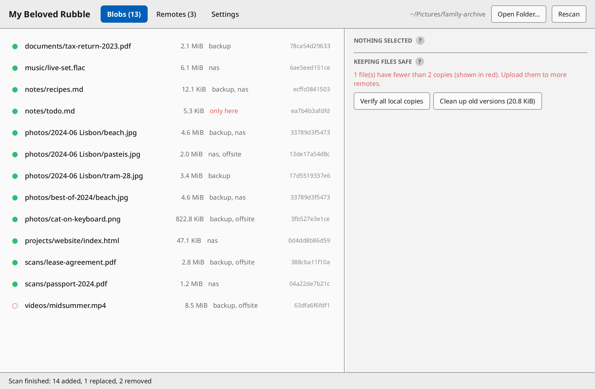
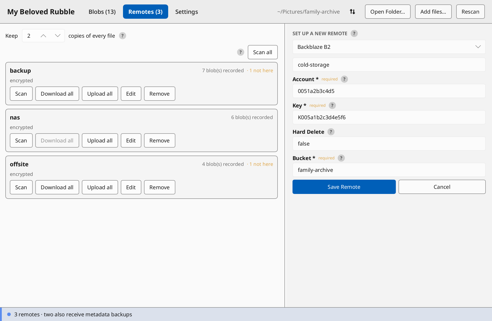

# my beloved rubble

Content-addressed folders in the spirit of git-annex, with rclone remotes.

`mbr` comes with a GUI written in [Slint](https://slint.dev) and a CLI. It is licensed under [AGPL](LICENSE).

<p align="center">
  
</p>

<p align="center">
  
</p>

## The model

Attach mbr to any folder (`mbr init`, or "Open Folder" in the GUI). From then on, whenever the folder is inspected (a scan), every regular file in it is moved into a hidden content-addressed store and replaced by a symlink, so it still opens like a normal file. Stored blobs are read-only: a program that writes into a file in place gets an error instead of silently changing content stored under its old hash (saving a new file over the name works, and is recorded as a new version):

```
folder/
  .mbr/
    blobs/fa/2e/fa2e38…(full sha256)   the actual content
    db/                               metadata (an iroh-docs replica)
    rclone.conf                       repository-local rclone config
    local.json                        per-machine state, never synced
    corrupt/                          blobs that failed verification
    tmp/                              scratch space
  fruits.png -> .mbr/blobs/fa/2e/fa2e38…
```

`.mbr/db` tracks:

- **paths** — every name the folder ever held: which blob it pointed to, when it was added, when it was removed. Replacing a file's content closes the old row and opens a new one, so previous versions stay addressable as long as their blobs are stored somewhere.
- **blobs** — hash → size.
- **remotes** — named rclone targets (e.g. `backup` → `s3:bucket/mbr`).
- **blob_remotes** — which blobs are known to live on which remotes.
- **metadata_remotes** — remotes chosen to hold metadata backups.
- **settings** — folder settings, such as the minimum number of copies.

For each file the UIs show: size, hash, whether the content is present locally (the filesystem is the source of truth for that), which remotes store it, other names — current or past — pointing at the same blob, and previous versions of the name with where those old blobs still live.

## Remotes

Blobs are pushed to rclone remotes named purely by hash, in the same sharded `fa/2e/fa2e38…` layout, with no metadata. Every remote is automatically wrapped in an rclone `crypt` remote keyed by the folder's master password. Each attached folder owns its rclone configuration at `.mbr/rclone.conf`.

### Setting up a remote

mbr hardcodes a short setup form for most rclone backends (local folders, SFTP, SMB, WebDAV, R2, S3, B2, Azure, GCS, Drive, Dropbox, OneDrive, pCloud, and many more; see `mbr remote types`) — derived from rclone's documentation and cross-checked against the embedded rclone's own metadata at test time (`cargo test`), so a renamed option upstream fails the build instead of producing a form rclone silently ignores.

In the GUI, pick a backend and fill in the generated form; in the CLI, `mbr remote types` lists the backends and their fields, and `mbr remote setup <name> <type>` asks for them. Answers are handed to rclone in one shot (`config/create` with prefilled parameters); anything rclone still needs afterwards — typically a browser sign-in for OAuth backends — comes back as a single question the frontends relay.

For OAuth backends (Google Drive, Dropbox, OneDrive, …) the form is empty, or nearly (a GCS project number, a Zoho region): the sign-in happens in the browser, and the auth link is also printed (CLI) or shown inline (GUI) in case no browser opens. The GUI answers rclone's "use a web browser?" question yes by itself, since it runs on the user's desktop; the CLI asks it, as it may run on a machine without one. Fields rclone says to leave blank (OAuth client ids, service accounts, …) are left off the forms too; any rclone option, on the form or not, can be given with `mbr remote setup <name> <type> --set KEY=VALUE` (repeatable; form fields given this way aren't asked) or changed later with `mbr remote edit <name> --set KEY=VALUE`.

### Encryption and layout

A master password must be set (`mbr config password`, or the Settings tab) before any remote can be added: every remote is encrypted with it. A remote named `drive` becomes three rclone sections, which are never shown:

```
[_root-mbr-drive]    the backend itself, at its root
[_plain-mbr-drive]   type = alias
                     remote = _root-mbr-drive:<bucket/>mbr-<folder id>
[_crypt-mbr-drive]   type = crypt, password = the master password
                     remote = _plain-mbr-drive:
```

and the mbr remote `drive` targets `_crypt-mbr-drive:`, so blobs and their names are encrypted.

The folder id is 6 random bytes in hex, made once and kept in the database, so each folder stores in its own `mbr-<id>` directory and several folders can share one storage account. Metadata backups go on `_root-mbr-drive`, next to `mbr-<id>`.

The master password is set once, before the first remote is added, and can't change. It is saved, with a check, in the folder's `.mbr/local.json` (mode 0600), which is never synced or backed up.

### Scanning remotes

Scanning a remote lists everything stored there and makes the database match: blobs recorded there but gone lose their record, and every blob found is recorded as stored there. Blobs the database has never heard of (pushed from another folder, say) are added too, and given a name in the `unnamed/` folder: `unnamed/<hash>`, a symlink like any other tracked file, dangling until the blob is downloaded. Rename or move it like any other file.

## Keeping files safe

Each file has *copies*: the local blob, if present, plus every remote that stores it. The folder keeps a minimum number of copies (default 2; `mbr config min-copies N`, or the Remotes tab); files below it are flagged as at risk.

- **Freeing space** (`mbr drop`, "Free up space"): removes local copies, but only of blobs that at least *min-copies* remotes are confirmed to hold right now. Each remote is asked directly rather than trusting the records, and its size must match. The file stays listed (dangling) and can be downloaded again.
- **Verifying** (`mbr fsck`, "Verify"): re-hashes local blobs; one that no longer matches is moved to `.mbr/corrupt/` so it counts as missing and can be downloaded again. `--remote` (or "Verify on remote") downloads a remote's copies to check them; a corrupt copy is deleted there, so pushing again replaces it.
- **Old versions and deleted files** (`mbr gc`, "Clean up old versions"): blobs no current file points at. `gc` drops their local copies under the same minimum-copies rule; `gc --purge [--older-than DAYS]` deletes them everywhere, remotes included, after confirmation.

## Metadata backups

Remotes store blobs by hash only: the names, folders and history of the files live in `.mbr/db`. If the folder is lost, its remotes alone would come back as a heap of nameless files. So the database is backed up separately. It is not content-addressed like a blob, but encrypted with the folder's **master password** and uploaded to every remote chosen for it, replacing the previous backup:

```
<bucket or folder>/mbr-metadata-<backup id>.tar.gz.encrypted
```

holding `mbr-metadata.json`, the whole database including the remote settings, in a tar.gz. The backup id is 8 bytes of an Argon2id hash of the master password, in hex: the backup is found again knowing only the password and where the remote is, and the name makes the password no easier to guess than the content does. It is an [age](https://age-encryption.org) file encrypted to the password (scrypt), so it can also be opened without mbr: `age -d mbr-metadata-…. tar.gz.encrypted | tar xz`. The password can't be recovered: without it the backups are unreadable. Folders sharing a remote and a master password share the backup name too, so give them different passwords.

A backup is restored into a folder that isn't an mbr folder yet, instead of `mbr init` (`mbr restore`, or the choice the GUI offers when opening such a folder), from any of:

- a remote: the master password and the remote's settings, set up in a throwaway rclone config, then the backup made with that password is downloaded from where they point;
- an encrypted backup file and the master password.

The backup's database and rclone config become the folder's, so its remotes, folder id and all come back as they were. Every file reappears as a dangling symlink (a file already in the way is kept, and the next scan records it as a new version), and the content can then be downloaded. There is no merging into a folder in use.

## Future plans

The goal is to have a bunch more options to make it easier to deal with large numbers of files and automate their backups, checking and custom rules.

In the meantime, we hope to get multi-machine and Android support: phones and machines would sync the metadata using _iroh_, then type the password and gain access to all the files, downloading them directly from the remotes. Syncing is bidirectional and conflicts would be rare and easy to handle, so phones can also easily add new files by just reusing the rclone configurations of the other machines to upload them, then syncing the metadata.

`mbr` is designed for power-users, but eventually a "simple mode" app can be developed that allows a non-tech family member, for example, to just share a bunch of pictures and they get all uploaded and synced.

## Building

```
cargo build --release   # target/release/mbr and target/release/my-beloved-rubble
```

The screenshots in `docs/static/screenshots` are rendered from the real UI over made-up data:

```
cargo run --release --features screenshots --bin screenshots
```

Rclone is embedded through `librclone`; building requires a Go toolchain and C compiler, but no separate `rclone` executable is required at runtime.

## Releases

Pushing a `v*` tag builds and publishes a GitHub release with archives for Linux and macOS (x86_64 and arm64), plus a Windows x86_64 installer. Each archive holds both binaries, `mbr` and `my-beloved-rubble` (and a `My Beloved Rubble.app` bundle on macOS); the release also carries a `SHA256SUMS` file. Running the `release` workflow by hand builds the same artifacts without publishing a release.

On Windows, enable **Developer Mode** (Settings → System → For developers) before using mbr: tracked files are stored as symlinks, which normal users can only create with that setting.

On Linux the build needs `pkg-config`, `clang`/`libclang-dev` (for bindgen), and the fontconfig, freetype, X11, xkbcommon, OpenGL and Wayland development packages.
